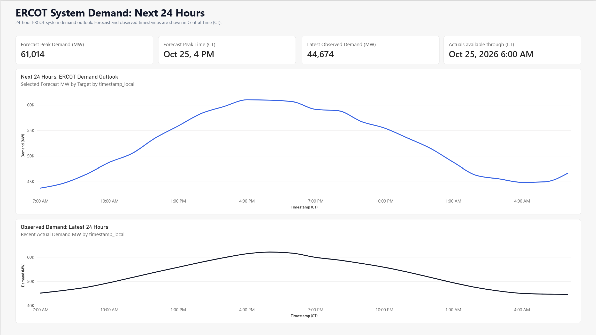
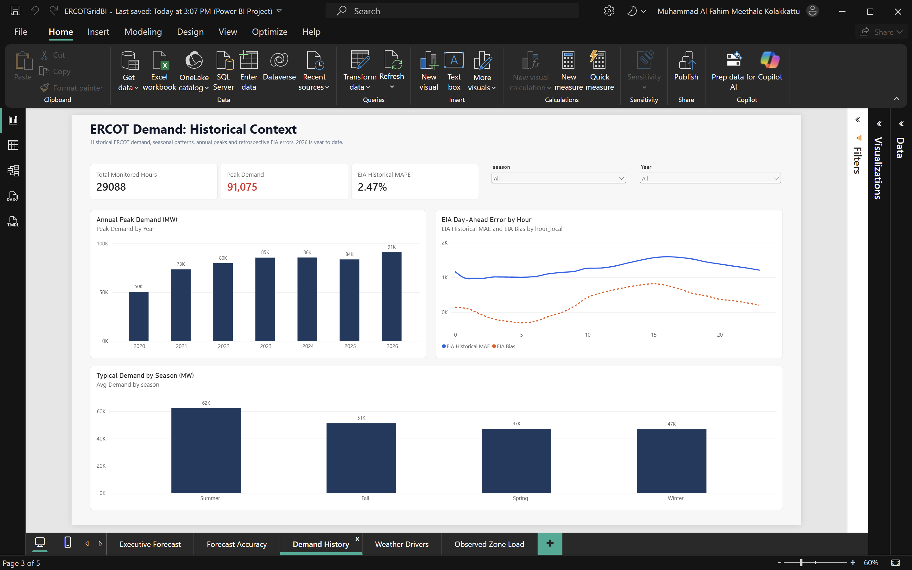
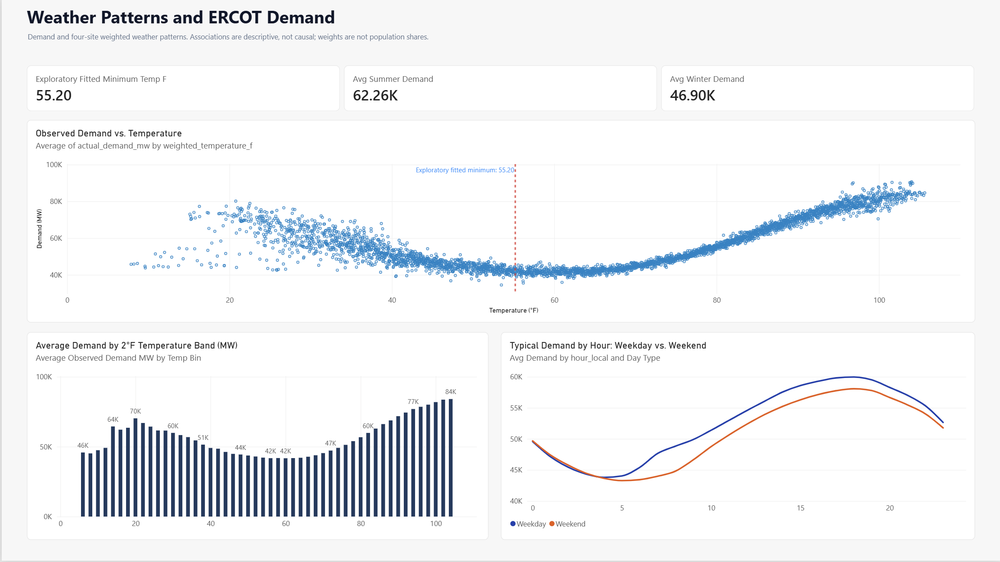
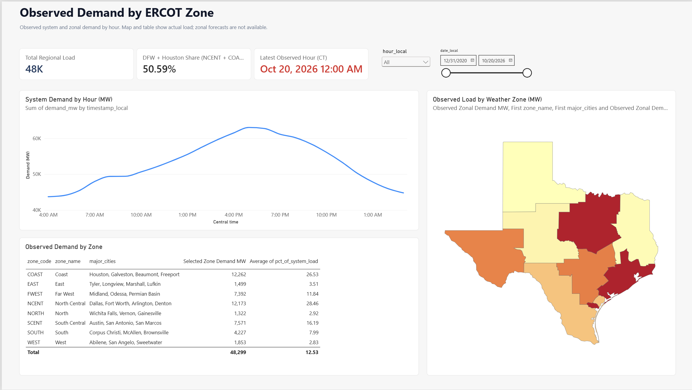
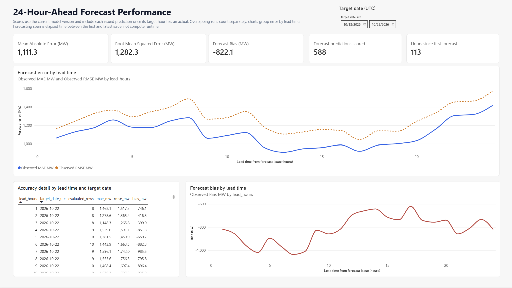
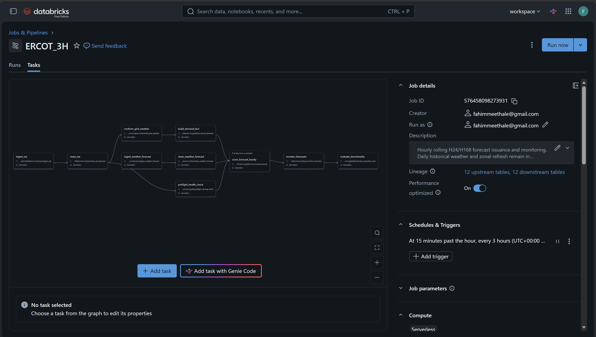
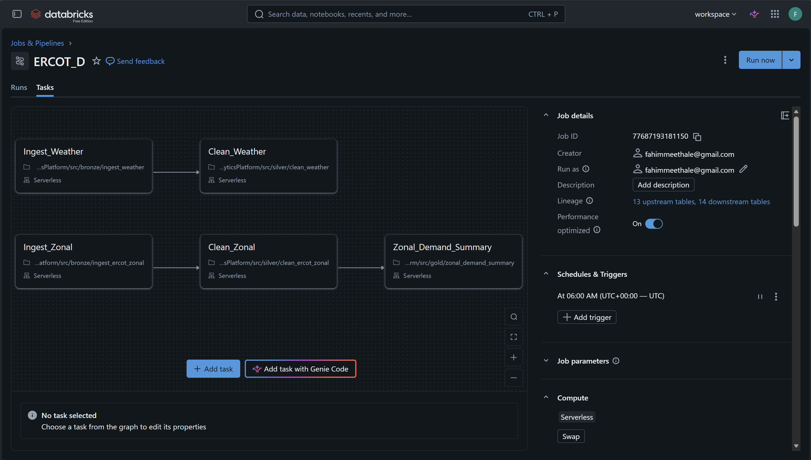
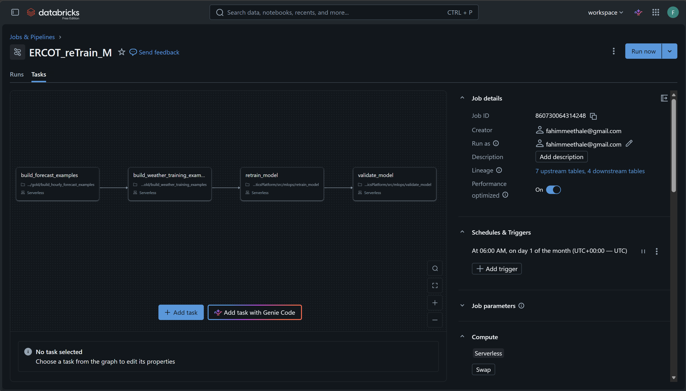

# ERCOT Demand Forecasting & Operational Analytics Platform

An end-to-end, production-style platform for hourly system-wide ERCOT electricity-demand forecasting and operational analytics, built on a Databricks Medallion lakehouse (Bronze → Silver → Gold), a direct multi-horizon LightGBM forecasting model, and a Power BI semantic layer for operational decision support.

The forecast targets system-wide ERCOT demand. The observed zonal page disaggregates historical load by ERCOT weather zone; it does not extend the forecasting model to zone-level predictions.

## What this platform does

- Ingests EIA-930 actual system demand via a high-water-mark incremental pipeline with a configurable restatement buffer to handle late EIA revisions, alongside ECMWF weather forecasts and observed ERCOT weather-zone demand.
- Conforms and standardizes source data across layers — UTC timestamps drive all joins, windowed aggregations, and model training; Central Time (America/Chicago) is applied only at the reporting boundary.
- Publishes a rolling 24-hour system-demand forecast every three hours using point-in-time-safe weather features and lag-structured historical demand context, with strict forecast-origin boundaries to eliminate look-ahead leakage.
- Scores every issued forecast against matured EIA actual demand, disaggregated by forecast lead and target period, tracking MAE, RMSE, and signed bias as actuals are revised and settled.
- Selects models using chronological rolling windows with a strictly untouched final holdout period and a seasonal-naive daily baseline as a reference — not random row splitting.
- Surfaces forecasts, observed demand history, population-weighted weather patterns, observed zonal loads, and rolling model reliability in a structured Power BI semantic model.

EIA day-ahead forecasts are excluded as a model input or benchmark. EIA-930 actual demand is the sole source of observed outcomes and training labels. Because EIA-930 explicitly states that demand data may be revised after initial publication, every forecast is scored retrospectively against settled actuals at that target timestamp, with the actual-data watermark surfaced in the report.

## Power BI report

The report separates forecast series from observed actuals. All report-facing timestamps are rendered in Central Time (America/Chicago); all underlying data joins are resolved in UTC. Forecast values represent the model's issued prediction at a given origin; actuals represent the EIA-settled demand for the same target hour.

### Executive forecast

Presents the rolling 24-hour system demand forecast alongside the expected peak demand and its projected timing, the latest ingested actual, and the current EIA actuals watermark.



### Historical demand

Tracks long-term system demand levels, annual peak observations, multi-year seasonal decomposition, and intraday load shape distributions.



### Weather and demand patterns

Explores the empirical relationship between observed system load and population-weighted ambient temperature, including seasonal load curves and the non-linear temperature-demand response across ERCOT's climate zones.



### Observed regional zonal demand

Disaggregates observed ERCOT weather-zone load across a Texas geographic map and a zone-level summary table. Selecting a zone cross-filters the zonal visuals; the system-wide demand trend is always rendered at the system level.



### Forecast reliability

Tracks model error against settled EIA actual demand by forecast lead hour and target period. A pending or missing score indicates insufficient eligible forecast/actual pairs for that lead-period slice — it is not a zero-error result.



## Databricks workflows

Three automated workflows separate forecast serving, supporting data refresh, and model retraining by cadence and compute sensitivity.

### Three-hour forecast and monitoring

Incrementally refreshes issue-time weather vintages and EIA actual demand, applies Silver conformation and Gold Delta MERGE upserts, validates model readiness, publishes the rolling 24-hour forecast, and refreshes forecast monitoring metrics against newly matured actuals.



### Daily supporting-data refresh

Refreshes historical weather and observed ERCOT weather-zone demand, then rebuilds the Gold zonal summary table consumed by the Power BI semantic model.



### Monthly model retraining

Constructs point-in-time training examples with issue-aligned weather vintage selection, trains a LightGBM candidate across chronological rolling windows, scores it on a held-out final period, and applies the configured win-rate and peak-hour promotion gate before registering the model in MLflow.



## Data flow and architecture

```text
EIA-930 actual demand ─┐
Weather forecasts ─────┼──> Bronze: source-aligned raw records (high-water-mark, restatement buffer)
ERCOT zone actuals ────┘                 │
                                         v
                              Silver: conformed, standardized, quality-gated
                                         │
                                         v
                              Gold: analytics and serving layer
                               ├─ observed demand facts (idempotent Delta MERGE)
                               ├─ point-in-time training examples
                               ├─ rolling 24-hour forecast history and latest
                               ├─ forecast monitoring metrics (MAE, RMSE, Bias by lead)
                               └─ observed zonal demand summaries
                                         │
                                         v
                                     Power BI semantic model
```

PySpark and Delta Lake handle distributed transformations and all table writes. Bronze preserves source-aligned records with raw API envelope archival for lineage and replay. Silver applies standardization, null-safe data-quality rules, and availability-state columns (`AVAILABLE` / `NOT_YET_PUBLISHED` / `MISSING_HISTORICAL`). Gold contains analytics-ready serving and modeling products. All forecast features are bounded to information available at the forecast origin timestamp to prevent look-ahead leakage. UTC defines storage, joins, and model training; Central Time is applied only at the reporting boundary.

## Forecast evaluation

For each eligible (forecast origin, target hour) pair, the project compares the issued predicted demand against the EIA-settled actual demand at that same target timestamp. MAE describes typical absolute error magnitude, RMSE penalizes larger misses more heavily, and signed bias indicates systematic over- or under-forecasting direction. Every score is reported alongside its evaluated row count, forecast lead, model version, and actual-data watermark, because EIA actuals may be revised after initial publication.

Model selection uses strict chronological rolling windows with an untouched final holdout period — never a random row split, which would contaminate temporal ordering and introduce look-ahead bias. A seasonal-naive daily baseline is used as a reference signal during candidate evaluation and automated promotion gating. This is not a claim that the model beats any external published EIA forecast; that benchmark comparison was excluded because the archived EIA-930 day-ahead values cannot be verified as same-issue-time, same-lead observations for this project's forecast horizon.

## Technology stack

**Python · SQL · PySpark · Databricks · Spark · Delta Lake · LightGBM · MLflow · Power BI · DAX · Pandas · NumPy · SciPy · Matplotlib**

## Local checks

Run the deterministic local test suite from the repository root:

```powershell
python -m pytest -q
```

These checks validate deterministic local logic including ingestion contracts, schema-safe MERGE guards, training data contracts, and feature generation. They do not execute Databricks workflows, validate live Unity Catalog tables, measure cloud compute costs, or refresh the Power BI semantic model.
