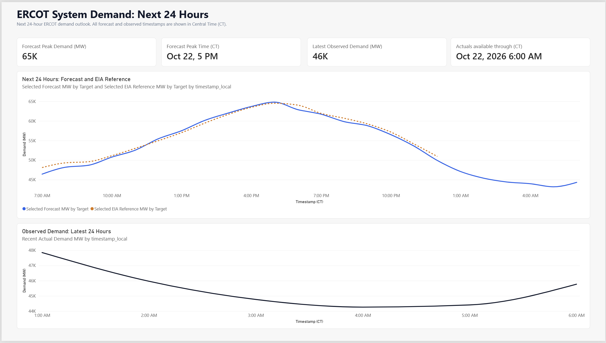
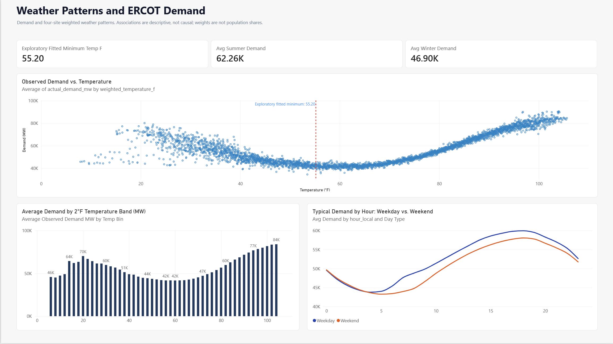
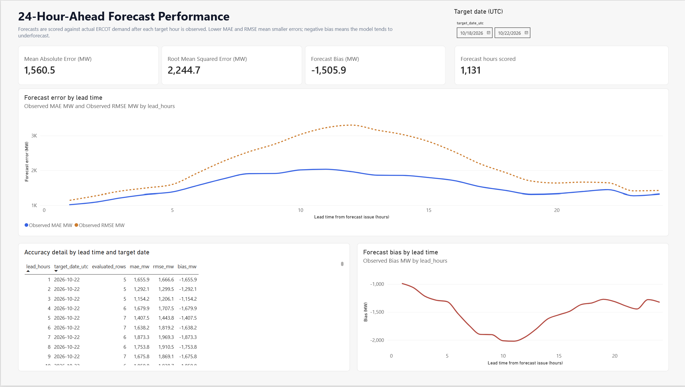
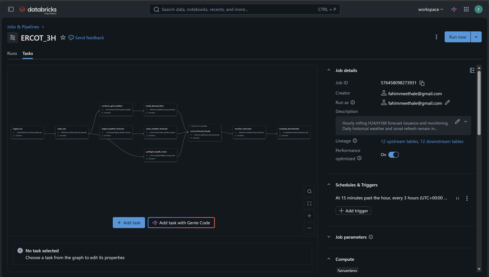
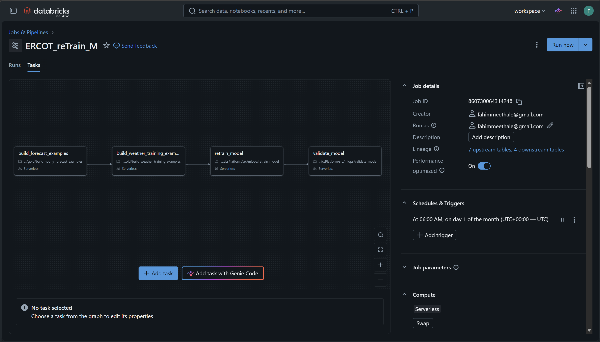

# ERCOT Demand Forecasting and Operational Analytics

This project builds an hourly, system-wide ERCOT electricity-demand forecast and an analytics layer for understanding observed demand. It uses a Databricks lakehouse for ingestion and processing, a LightGBM model for forecasting, and Power BI for operational and historical analysis.

The forecast is for ERCOT as a whole. The zone page reports observed zonal load; it does not claim to forecast demand by zone.

## What the project does

- Ingests EIA-930 actual system demand, weather forecasts, and observed ERCOT weather-zone demand.
- Cleans and conforms source data, retaining UTC timestamps for joins and Central Time for Texas-facing reporting.
- Produces a rolling 24-hour system-demand forecast every three hours, with issue-time weather features and historical demand context.
- Evaluates issued forecasts against actual demand after the target hours become available, including error by forecast lead.
- Uses chronological validation, a final holdout period, and a seasonal-naive reference during model selection.
- Presents current forecasts, actual demand, weather patterns, observed zonal loads, and model reliability in Power BI.

EIA day-ahead forecasts are not used as a model input or comparison. EIA actual demand remains the source of observed outcomes and model labels. The EIA-930 documentation distinguishes actual demand from a balancing authority's submitted day-ahead forecast, and notes that demand data can be revised after initial publication. The project therefore scores forecasts against observed actuals as they mature and keeps their timestamps explicit.

## Power BI report

The report uses Central Time for Texas-facing timestamps. Forecast and observed values are distinct series: forecasts describe future demand, while actuals describe published outcomes.

### Executive forecast

Shows the next 24 hours of system demand, expected peak and timing, the latest observed value, and the time through which actuals are available.



### Historical demand

Shows long-term demand levels, annual peaks, seasonal patterns, and hourly demand shape.


### Weather and demand patterns

Explores the relationship between observed load and population-weighted weather, along with seasonal and hourly demand patterns.



### Observed regional zonal demand

Shows observed ERCOT weather-zone load on a Texas map and in a zone summary. Selecting a zone filters zonal visuals; the system-wide demand trend remains system-wide.


### Forecast reliability

Shows model error against matured actual demand by forecast lead and target period. A missing or pending score means there are not yet enough eligible forecast/actual pairs for that slice; it is not a zero-error result.



## Databricks workflows

The workflows separate recurring forecast serving, slower supporting data updates, and model retraining.

### Three-hour forecast and monitoring

Refreshes issue-time weather and EIA actual demand, updates the conformed and Gold demand facts, checks model readiness, publishes the rolling 24-hour forecast, and refreshes forecast monitoring metrics.



### Daily supporting-data refresh

Refreshes supporting weather history and observed zonal demand, then updates the zonal summary used by Power BI.


### Monthly model retraining

Builds point-in-time training examples, trains a candidate model, evaluates it on chronological validation and holdout periods, and applies the configured promotion checks.



## Data flow and design

```text
EIA-930 actual demand ─┐
Weather forecasts ─────┼──> Bronze: source-aligned records
ERCOT zone actuals ────┘                 │
                                         v
                              Silver: cleaned and conformed
                                         │
                                         v
                              Gold: analytics and serving
                               ├─ observed demand facts
                               ├─ point-in-time training data
                               ├─ hourly forecast history/latest
                               ├─ forecast monitoring metrics
                               └─ observed zonal summaries
                                         │
                                         v
                                     Power BI
```

Spark and Delta Lake handle distributed transformations and table writes. Bronze preserves source-aligned records; Silver applies standardization and data-quality rules; Gold contains serving and analytical products. Forecast features are limited to information available at the forecast origin to reduce look-ahead leakage. UTC timestamps define storage and matching; Central Time supports local calendar features and report labels.

## Forecast evaluation

For each eligible forecast and target hour, the project compares predicted demand with the EIA-reported actual demand for that same target. MAE describes typical absolute error, RMSE gives larger misses more weight, and signed bias indicates average over- or under-forecast. Scores should be read with the number of evaluated rows, the forecast lead, the model version, and the actual-data watermark. EIA actuals may be revised after initial publication, so evaluation is retrospective and can change as corrected actuals arrive.

Model selection uses chronological rolling windows and a held-out final period rather than a random row split. A seasonal-naive forecast is used as a reference during training and promotion analysis. This is not a claim that the model beats an external EIA forecast; that comparison was removed because the available EIA-930 forecast is not a verified same-issue-time, same-lead benchmark for this project's forecast.

## Technology

**Python, SQL, PySpark, Databricks, Spark, Delta Lake, LightGBM, MLflow, Power BI, DAX**

## Local checks

Run the local Python checks from the repository root:

```powershell
python -m pytest -q
```

These checks cover deterministic local code. They do not execute Databricks workflows, validate live Unity Catalog tables, measure cloud compute, or refresh the Power BI semantic model.

## Further reading

- [Project guide](docs/project_guide.md) — detailed data contracts, workflows, modeling choices, and operational notes.
- [Remaining-work handoff](docs/things_to_fix.md) — current decisions, open verification items, and the safe sequence for future changes.
