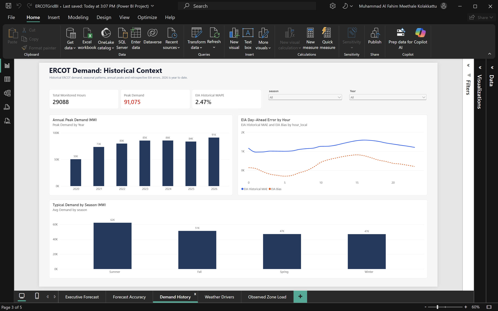
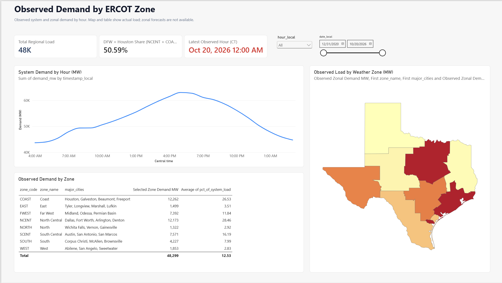
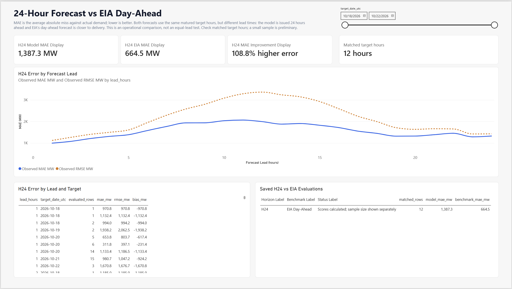
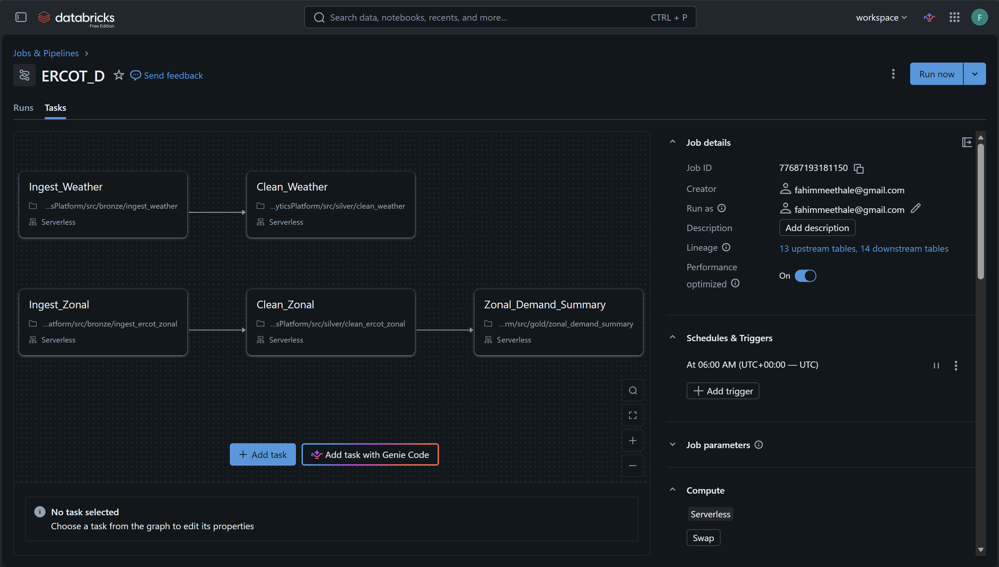

# ERCOT Demand Forecasting and Operational Analytics

I built this project to turn ERCOT demand, weather, and regional load data into a reliable hourly demand outlook and analysis people can use. It brings together a Databricks lakehouse, a 24-hour-ahead system-demand model, forecast monitoring, and a five-page Power BI report.

The forecast is for **ERCOT system-wide demand**. The regional page shows observed demand by weather zone; it does not present zonal forecasts.

## What it does

- Refreshes a rolling 24-hour system-demand forecast every three hours.
- Predicts a correction to the demand observed at the same hour on the previous day, using LightGBM, demand history, calendar features, and weather information available at forecast issue time.
- Preserves forecast issues and checks their errors against actual demand as the actuals become available.
- Compares the model with EIA's day-ahead forecast on the same target hours when both forecasts and actuals are available.
- Provides historical, weather, regional-demand, and forecast-reliability views in Power BI.

## Power BI report

The report is designed to move from the current system outlook to historical context, weather relationships, observed regional load, and forecast accuracy.

### Executive Forecast

The current system outlook, forecast peak and timing, latest observed demand, and the available EIA reference.


### Historical Demand and Benchmarks

Longer-term demand patterns, annual peaks, seasonal context, and historical EIA forecast error.



### Weather and Demand Patterns

Observed demand patterns across temperature ranges, seasons, and times of day.


### Observed Regional Zonal Demand

Observed load by ERCOT weather zone, with a Texas map and zone-level summary.



### Forecast Reliability

Forecast error by lead time and the matched comparison between the model and EIA.



## Databricks workflows

The workflows separate frequent forecast serving from slower retrospective updates and monthly model retraining.

### Three-hour forecast and monitoring

Refreshes issue-time inputs, updates the demand fact, checks serving readiness, publishes the H24 forecast, and updates monitoring metrics.


### Daily data refresh and benchmark evaluation

Refreshes weather and observed zonal data, builds zonal summaries, and evaluates the H24 forecast against EIA when matched actuals are mature.



### Monthly model retraining

Builds training examples, trains a candidate model, validates it, and promotes it only when it passes the configured selection gate.


## Data and architecture

```text
EIA-930 ───────────────┐
Open-Meteo weather ────┼──> Bronze: source-aligned raw data
ERCOT zonal demand ────┘                │
                                        v
                              Silver: cleaned and conformed
                                        │
                                        v
                              Gold: analytics and serving
                               ├─ demand and forecast facts
                               ├─ training and scoring data
                               ├─ forecast monitoring
                               ├─ H24/EIA benchmark results
                               └─ observed zonal summaries
                                        │
                                        v
                                    Power BI
```

Spark and Delta Lake handle distributed ingestion, transformations, joins, data checks, and table writes. Processing follows Bronze, Silver, and Gold layers so raw source records remain separate from cleaned data and business-ready outputs. Forecasts retain their issue times, and model features are limited to information available at that issue time to reduce look-ahead leakage. UTC is used for storage and matching; Central Time is used for Texas-facing time labels and local calendar features.

## Forecast evaluation

The model's mean absolute error (MAE), root mean squared error (RMSE), and bias are calculated against matured actual demand. The EIA forecast is scored against those same actual target hours. Lower MAE and RMSE indicate smaller errors; negative bias means underforecasting.

The comparison uses the same target hours, but the forecasts have different lead times: the model is issued 24 hours ahead, while EIA's day-ahead forecast is generally available closer to delivery. It is an operational comparison, not an equal-lead model experiment. The latest saved sample contains **12 matched target hours**; in that sample, the model's errors are higher than EIA's. This is an early result and too small to establish stable long-run performance. Scores should be interpreted alongside the matched-hour count and updated as more actuals mature.

## Technology

**Python, SQL, PySpark, Databricks, Spark, Delta Lake, LightGBM, MLflow, Power BI, DAX**

## Local checks

From the repository root, run the Python contract tests with:

```powershell
python -m pytest -q
```

These tests cover local deterministic code. They do not run Databricks jobs, verify live Unity Catalog tables, measure compute usage, or refresh the Power BI report.

## Project guide

See [the project guide](docs/project_guide.md) for detailed data contracts, workflow dependencies, modeling choices, known limitations, and guidance for future changes.
